# Shared-world architecture investigation

Audit baseline: `origin/main` **103d8ee**, including merged persistent-world, text-QC and canonical-profile changes. No production inspection, deployment, migration or paid call was performed. Code capability, local proof and live operation are separate claims.

## Current architecture and reuse

| Responsibility | Actual implementation | Operational boundary / gap |
| --- | --- | --- |
| Profiles/canon | `characters.ts` defines five personalities, occupations, schedules, styles, independent initial states. `tess.server.ts` contains Tess's detailed bible. DB `characters` supplies display records. | Code canon exists; generated claims must not rewrite it. Claire is a school librarian; Mrs. Abernathy is the principal, Becca is Maya's Pittsburgh college friend, Sam a clinic tech. Preserve these rather than invent replacements. |
| Visual identity | Existing profile assets, `canonical-profile.server.ts`, immutable SHA-256 anchors and shared image service. | Actual profile JPEG bytes go to reference edits, never a prior generated photo. One visual-design screen; resemblance is not guaranteed. Live multi-scene acceptance still pending. |
| User conversations | Authenticated server functions load an owned conversation; `runTurn` invokes strict structured Luna output, applies validated deltas and stores delayed bubbles. | No cross-character transcript sharing. One main text call per turn; additional vision/image checks can occur. Debrief is a separate request. |
| Memory | `memories` has per-conversation summaries, type, importance and timestamps. Pure lexical recall ranks by relevance/recency/importance, normally returning 18, from up to 2,000 loaded rows. | No embedding API. Extraction rides in the dialogue response, not a separate memory call. Old summaries are not typed objective truth. |
| Continuity | `world_records` separates pending intentions and tentative/confirmed facts with evidence, due dates, expiry/backoff. | New explicit promises can survive sessions. Old conversations are not retroactively converted. NPC claims are not automatically canonicalized. |
| Daily routines | Code-defined schedules and seeded disruptions; `character_world_state` checkpoints activity, category, next transition/check. | Locations are broad/free-text, not constrained place entities. Checkpoints depend on completed backend ticks. |
| World history | `world_events`, stable `shared_events`, `event_participants`; seeded weekly social plans and bounded multi-week storyline progression. | Objective events already exist. Some weekly events are templates rather than verified physical encounters. They must not be confused with a precise shared-location simulation. |
| Social relationships | `npcs`, `social_links` support family, coworker, friend, acquaintance and cross-character edges with reason/opinion. | Beyond user-character scores already exists. It is not yet a general experience-driven social planner or romance system between every pair. |
| Knowledge boundaries | `character_knowledge` rows distinguish witnessed/told/rumor/interpretation; prompts query only that character. | Existing simulated secondhand sharing uses a deterministic friend-link probability and a six-hour delay, without a separate communication receipt. New explicit events should use actual invitation/exchange records instead. Private user chats are not a permissible propagation source. |
| NPC lives | Canon NPC seeds, reusable unique keys and contextual event participation. | Tiered lightweight NPCs, not full autonomous LLM agents. No independent minute-by-minute inference or general NPC memory engine. |
| Dialogue behavior | Topic-saturation/closure rules, deterministic voice cleanup, independent relationship dimensions and intent-aware stages. | Prompt guidance mitigates loops but does not prove model compliance. Bounded story states resolve; generic improvised conversation problems can still recur without structured events. |
| Communication | Personality/context scoring, follow-up intentions, photo opportunities; quiet hours, mute, character availability and quotas. | Not a requirement to message on a timer. AI calls are capped independently from structured progression. |
| Media | One image attempt with ledger/outbox; canonical references, optional Mabel, private storage, text and visual screening, atomic attachment/state/memory delivery. | No automatic uncertain-image retry. Existing curated/old/prepared photos remain preserved. Group identities are not supported merely because an event exists. |
| Scheduler | Authenticated POST `/api/public/jobs/world-tick`; global DB lease, durable cursor, bounded catch-up, recovery and push sweep. Opt-in GitHub Actions workflow calls it every five minutes. | Works without a browser **if** migration, secrets, published backend and scheduler are activated. Source code does not prove live scheduler activity. GitHub schedules can lag. |
| Time modes | Real-Time uses actual time/availability and backend initiation. Practice suppresses real-clock initiation; deterministic read-only schedule preview exists. | Practice is not yet a persistent accelerated alternate universe. Never change the host clock or advance live commitments through a debug override. |
| Debugging | Hidden character diagnostics, world timeline, jobs, intentions, decisions, media comparison. | Existing UI polling only observes; it is not the scheduler. Live health must be checked using worker timestamps/job results. |

Existing tables: `characters`, `conversations`, `messages`, `tess_state`, `memories`, `user_profile`, `tess_life`, `generated_images`, `world_events`, `push_subscriptions`, `job_runs`, `world_control`, `npcs`, `social_links`, `shared_events`, `event_participants`, `character_knowledge`, `character_world_state`, `world_records`, `media_attempts`. Existing migrations through 0010 are retained. Keep data, histories, appointments and score math unchanged.

## External architecture patterns investigated

Read-only source review of [a16z-infra/ai-town](https://github.com/a16z-infra/ai-town), commit `8e05997f2409275669c8344b84a51692e83f3f33`, including README, agent state machine, conversation memberships and memory modules. It uses Convex transactions/shared state, durable agent operations, proximity/invitation state, bounded conversations and remembered conversations. Its README cites [Generative Agents](https://arxiv.org/abs/2304.03442): observation, retrieval, planning and reflection. The paper was not independently re-fetched here; this is a source/pattern review, not a reproduction of its empirical results.

Reuse the patterns, not the stack: authoritative state, explicit participants, bounded agent actions, separate observation/interpretation, relevant memory retrieval and a durable scheduler. Do not import Convex, PixiJS, a second auth system, continuous pairwise LLM conversations or a full game engine. Existing Postgres transactions and server modules fit the first proof.

## Smallest practical shared-world design

One tenant-scoped world per user, containing that user's primary characters and supporting NPCs. “One world” must not merge different users' private histories. Keep the present single application and database; use modules rather than six services:

- **World:** stable place registry, schedules, one current presence, canonical event/appointment state and bounded clock transitions.
- **Social:** explicit invitation transmission, independent responses, co-attendance, summarized exchanges and experience-backed link changes.
- **Character:** existing canon, private memories, interpretation, preferences and delta math.
- **Communication:** existing optional initiation, pending intentions, delayed outbox and notification claims.
- **Media:** existing shared generator with Phase 4B/4C protections. Event context is added only when known by the sender.
- **Scheduler:** existing authenticated tick with a lease and durable receipts. Structured changes remain cheap while paid calls are paused/capped.

Additive normalized tables should reference stable place keys and explicit plan participants, while continuing to project participant knowledge and memories into the existing tables. SQL transactions must enforce versions, tenant ownership, RSVP states and non-overlapping reservations. Do not infer attendance from a casual mention or scheduled date. AI characters may simulate accepted commitments; user attendance remains unresolved until explicitly reported.

A plan progresses proposal → invitation → independent RSVP → confirmed attendance → active → completed/missed/cancelled. Rescheduling invalidates old assumptions and requires renewed responses. An invitation makes only its recipient aware; other attendees do not automatically learn private RSVP details. Actual meetings create one canonical exchange with separate perspectives and memory IDs. Co-attendance alone is not friendship. Introductions may create acquaintance edges; deeper changes require repeated meaningful outcomes.

NPC tiers: primary characters use full existing engine; supporting NPCs retain stable names/roles, relationships and event participation; background population gets details only on demand. Never allocate a paid inference loop per NPC. A future map should read place/presence/event projections, with optional relationship views. It should not become an alternative source of truth or replace texting.

## Proof boundary before implementation

Implement a developer-controlled Ben/Claire gathering using reusable places, invitation/RSVP state, schedule/travel-conflict checks, one shared summarized interaction, separate memories and normal follow-up intentions. Advance existing plans inside the backend tick without additional AI calls. Do not seed a permanent Ben/Claire friendship, hardcode the user's actual family conversation, or pretend ordinary dialogue already creates general shared plans. A deterministic multi-day dry-run should use the same response/time rules on copied fictional state, with no live writes or paid calls.

Natural dialogue-to-plan extraction, autonomous opportunity selection across arbitrary places/NPCs, multi-reference group photos and a persistent accelerated sandbox are later phases. Local tests should prove the narrow slice and explicitly name unsupported acceptance scenarios.

## Implemented vertical slice

The proof is now implemented in `shared-world.ts` (deterministic availability/RSVP and copied-state preview), `shared-world.server.ts` (bounded progression/context), `shared-world.functions.ts` (authenticated allowlisted controls), and migration **0011_shared_world_plans.sql**. No dependency, provider/model change or continuous paid agent loop was added.

New tables:

- `world_places`: stable tenant/place keys and labels, with no invented street addresses.
- `social_plans`: canonical plan, organizer, place FK, time window, state/version, and explicit `user_attendance=not_reported`.
- `social_rsvps`: actual transmitted invitation channel and each character's independent response.
- `social_presence`: one primary-key presence per character during an active plan, with expiration.
- `social_exchanges`: one canonical summarized interaction per plan and actual accepted participants.

Service-only `shared_world_command` acquires a per-user transaction lock, checks expected versions, and atomically updates plans, invitations, presence, exchanges, existing knowledge/memories/social links/world events and optional follow-up intentions. Authenticated clients have owner-scoped read access only; the developer server action separately checks authentication and the existing allowlist. User IDs and character keys do not come from model-selected identity references. Plan IDs are stable and replay-safe. SQL guards overlapping accepted reservations with a conservative 30-minute travel buffer; availability checks cover travel lead-in, duration and return buffer. There is no road/pathfinding model.

Proposal knowledge belongs to Ben only. An explicit relayed/direct invitation creates Claire's knowledge; RSVP goes to host and recipient, not every character. A completed simulated meeting creates different host/guest personal memories and participant knowledge. Only an actual introduction can establish acquaintance; it cannot auto-upgrade friendship or romance. No private transcript or unrelated memory is read for the exchange. No user attendance or user actions are invented. Unknown/uninvited characters retain no knowledge of the shared plan.

The existing backend world tick processes up to eight open shared plans per selected user before paid initiation and regardless of AI-call budget. Routine transitions cost zero model calls. It then uses existing pending intentions and the normal character/outbox/push pipeline for optional autonomous follow-up; the SQL function itself does not fake an incoming message or phone notification. Current plan presence overrides the sender's activity/location context in normal turns and world checks. When completed, presence expires/removes and the ordinary schedule resumes. Shared-event photo context inherits Phase 4B text and Phase 4C reference/visual checks unchanged. **Group photography remains unsupported** by the current single-character media contract.

A seven-day copied-state preview uses the same RSVP/schedule rules and records no memories, relationship points, messages or live clock changes. This is a **preview of one plan**, not a full persistent Practice town or a multi-agent planner.

Reproducibility issue discovered in fresh PostgreSQL: migration 0004 added `(user_id,character_id)` uniqueness but failed to remove 0000's `conversations_user_id_key`. 0011 drops only that obsolete constraint with `IF EXISTS`; it retains `conversations_user_character_key`, all rows and histories. A live installation that already removed it sees no change for that statement.

### What remains proposed

Natural-language conversation → validated shared-plan actions is not implemented. The user's existing Ben/Claire family-gathering conversation is not mined, replayed or rewritten. The proof uses explicit developer controls; ordinary chat does not yet automatically transmit invitations. Autonomous spontaneous *selection* of arbitrary cross-character meetings, general NPC invitations/lives, meaningful disagreement/reconciliation/romance, detailed optional character-to-character dialogue and group photo identities remain future work. Existing storyline templates still operate alongside this slice; not every legacy free-text activity is converted into an enforced world-place reservation. Ad hoc conversation-only recurring problems can still loop; bounded plans/storylines resolve, but this is not a universal fix for all improvised topics.

Knowledge for **new shared plans** propagates only through recorded invitations/attendance. Existing weekly-event synthetic secondhand behavior was not silently changed. A later migration should replace it with explicit receipt events after reviewing existing histories. General introductions beyond an explicit relayed invitation/meeting still need an evidence-backed dialogue action schema.

## Developer review and test steps (no SSH)

1. Review/merge only when ready. In Lovable ask: **“Synchronize main, review and apply `drizzle/migrations/0011_shared_world_plans.sql` transactionally after confirming 0010 is installed. Preserve all existing data, retain per-character conversation uniqueness, and do not publish until validation is complete.”** Do not rerun old migrations or reset tables.
2. Retain existing server `OPENAI_API_KEY`, Supabase service bindings, `LOVABLE_CRON_SECRET` and VAPID configuration. No new model secret is needed. Retain `ENABLE_DEV_PHOTO_ACTIONS=true` and the exact account allowlist for developer controls. No model/provider or scheduler activation happens automatically in this branch.
3. Both Ben and Claire must already have Real-Time conversations. Open the hidden **Living world** page. The **Shared-world proof · Ben and Claire** panel is shown only to allowlisted developers. Pick a two-hour window at least 30 minutes ahead and within 14 days (for example Sunday October 25, 2026, 2 PM Eastern, if schedules permit). The input uses device local time; ensure the device is on Eastern time. Preview is read-only and may predict a decline.
4. **Create plan** adds the controlled fictional future proposal. Inspect: Claire has no invitation or attendance yet. **Relay invitation to Claire** explicitly transmits it. Run the existing **Run world tick** or let the configured cron run; her deterministic schedule/personality decision may accept or decline. Do not reroll plans to force consent. Inspect current RSVP/state/exchange records. Copy the plan ID into the panel after a reload to inspect/reschedule/cancel it.
5. The event progresses with real elapsed time on the backend. It can complete after downtime without replaying a dialogue backlog. Follow-ups remain optional and respect quiet hours, schedules, quotas and mode. Existing tick controls can cause paid normal replies/photos; the plan/RSVP/exchange itself does not. Real push additionally needs a subscribed device and valid VAPID configuration.
6. For accelerated proof without live writes or paid services, run `npx vitest run src/test/shared-world.integration.test.ts src/test/world-offline.integration.test.ts` locally/in Codex. Tests use disposable PostgreSQL, controlled time and mocked paid/push providers. Preview can inspect seven days safely, but cannot fast-forward live attendance. Never change the real system clock.

No deployment, remote migration, secret change, live message, actual phone push or paid photo was performed here. Existing published-app scheduler and provider health remain unverified from this workspace.

## Proof coverage and limits

New PostgreSQL tests exercise proposal/invitation privacy, independent RSVP, co-location and completion, distinct memories, nonattendee ignorance, participant follow-ups, declines, rescheduling/cancellation, bounded outage catch-up, overlapping reservations, stale/concurrent workers, tenant/RLS isolation, invalid invitation channels, idempotency and history/uniqueness preservation. The existing offline integration now also proves completed-plan follow-ups reach normal delivery and deduplicated **mock** push attempts without user messages. Existing offline photo tests and Phase 4B/4C tests continue to exercise the shared media path and canonical bytes; they do not demonstrate real generated faces are recognizable.

No claim is made that all 18 requested acceptance scenarios are fully implemented. NPC independent lives, general introduction extraction, a complete multi-day Practice world, all legacy activity reservations, group photos and real visual acceptance remain outside this first proof. Tests prove controlled mechanics, not live model judgment or production scheduling.

## Implementation roadmap

1. **This review:** additive shared plans, explicit invitation/RSVP, transactional meeting/memory projections, optional normal follow-up and observability. Validate fresh/existing schemas and the no-SSH proof.
2. **Dialogue bridge:** strict evidence-backed world actions in the existing reply schema; propose/relay/accept only with explicit source, correct actor and known event ID. Commit actions atomically with delivered messages; no memory scrape or auto-user attendance.
3. **Places and movement:** map existing schedules/employment to stable places, reservations, travel/transit and absence states. Reconcile legacy templates with the authoritative calendar; add cancellations/early departures for emergencies.
4. **Social planner and NPC tiers:** discover bounded opportunities from co-location, existing links, invitations and interests. Durable identity aliases for existing NPCs; summarized low-importance exchanges, sparse paid meaningful dialogue only after quotas and consent/channel checks.
5. **Knowledge receipts:** replace synthetic secondhand guesses with explicit communication records, confidence and visibility. Add reconciliation/interpretation while keeping objective events immutable.
6. **Separate Practice instance:** copied world/clock with its own IDs and budgets, replayable seeds and bounded multi-day advancement; never advance live commitments through a preview parameter.
7. **Media/model review:** verify reported deprecations and current replacements, price/account support, real fidelity/text acceptance; preserve original profile anchors. Add group identities only with actual co-attendance, per-person reference maps and tested provider support.
8. **Optional town view:** read-only map/location and relationship projections over the same data, after the engine is proven. No game engine is justified for this slice.

See `shared-world-cost-analysis.md`, its reproducible calculator and JSON scenarios for pricing provenance, model inventory, cache findings, NPC/primary cost scaling, replacement candidates and measured-vs-assumed boundaries.

### Further schema and acceptance notes

Existing `npcs` uniqueness is per user/owning-character/name, not a universal person ID. A later supporting-person registry should connect those contextual rows to stable tenant-person IDs and aliases; do not merge common names or rewrite established roles automatically. This proof creates no additional NPC records.

The plan status remains `proposed` before start; accepted RSVP rows determine readiness/confirmed attendance. There is no additional persisted `confirmed` status. User attendance reporting, early departures and a complete work/emergency calendar are later steps. Travel enforcement is a conservative buffer, not a geographic route simulation.

```mermaid
flowchart LR
    Cron[Authenticated backend tick] --> Lease[Lease and bounded queue]
    Lease --> Plans[Transactional plans and RSVP]
    Plans --> Meeting[One canonical exchange]
    Meeting --> Knowledge[Participant knowledge and memories]
    Knowledge --> Intent[Optional follow-up intention]
    Intent --> Character[Existing character turn and quotas]
    Character --> Media[Optional canonical-reference media checks]
    Character --> Outbox[Atomic delayed outbox]
    Media --> Outbox
    Outbox --> Push[Claimed normal notification]
```

Validation completed locally: full automated suite, TypeScript and production build; external text/image/push outputs are mocked in the controlled end-to-end tests. Review branch testing does not confirm live deployment configuration or real visual likeness.

Legacy user dates and promises that exist only in memory text are **not yet a complete reservation calendar**. They remain intact; this slice does not parse or move them. Check known commitments before creating a controlled plan. Full conflict detection against those old plans belongs to the evidence-backed dialogue/calendar bridge, not a guessed migration of prose.
